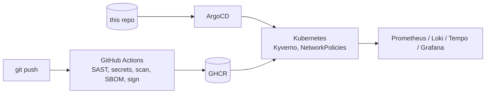

# SecurePipeline

[](https://github.com/tarikiguezarane/securepipeline/actions/workflows/ci.yml)
[](LICENSE)

**GitOps and DevSecOps platform** that deploys [VulnTrack](https://github.com/tarikiguezarane/vulntrack)
on Kubernetes, with security built into every stage: code, images, supply chain, cluster,
runtime and observability.

> Status: work in progress, built step by step following [ROADMAP.md](ROADMAP.md)
> (progress log in [JOURNAL.md](JOURNAL.md), both in French).

## Goals

- **Everything as code**: the cluster (Terraform), the deployments (Helm + ArgoCD) and the
  security rules (Kyverno, NetworkPolicies, Falco) live in Git and are reviewed like code.
- **Trusted supply chain**: every image is scanned (Trivy), described by an SBOM (Syft) and
  signed keylessly (Cosign + GitHub OIDC); the cluster only admits signed images (Kyverno).
- **Defence in depth at runtime**: non-root pods, resource limits, default-deny network,
  encrypted secrets, runtime detection.
- **Observable**: metrics, logs and traces of VulnTrack in Grafana, alert rules versioned in Git.

## Target architecture



Full diagram and control matrix in [docs/architecture.md](docs/architecture.md).

## Repository layout

```
terraform/          kind cluster, namespaces, ingress-nginx, ArgoCD bootstrap, cloud option
clusters/           GitOps entry point per cluster (ArgoCD app of apps)
apps/               ArgoCD Application manifests
charts/             Helm charts (demo app, VulnTrack)
policies/           Kyverno policies, NetworkPolicies, Falco rules
.github/workflows/  CI and the reusable security workflow
docs/               Architecture, threat model, control mapping
scripts/            Helper and check scripts
```

## Stack

Terraform · kind (OVHcloud / Scaleway option) · ArgoCD · Helm · GitHub Actions · Semgrep ·
Trivy · Gitleaks · Syft · Cosign · Kyverno · NetworkPolicies · OpenTelemetry · Prometheus ·
Grafana · Loki

## License

[MIT](LICENSE) © 2026 Tarik Iguezarane
