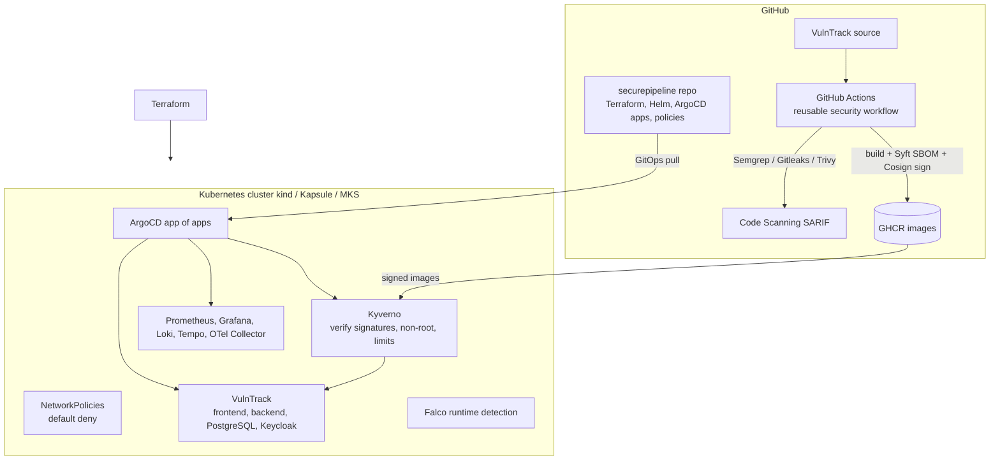

# Target architecture

## Security controls per stage

| Stage | Control | Tool |
|-------|---------|------|
| Code | Static analysis, secret detection | Semgrep, Gitleaks, pre-commit |
| Dependencies | Automated updates | Dependabot / Renovate |
| Build | Image and IaC vulnerability scan, SBOM | Trivy, Syft |
| Supply chain | Keyless signing and SBOM attestation | Cosign (GitHub OIDC) |
| Deployment | Git as single source of truth | ArgoCD |
| Admission | Signature verification, pod hardening | Kyverno |
| Network | Default-deny east-west traffic | NetworkPolicies |
| Secrets | Encrypted secrets in Git | Sealed Secrets / SOPS |
| Runtime | Suspicious behaviour detection | Falco |
| Observability | Metrics, logs, traces, alerts | Prometheus, Loki, Tempo, Grafana |
